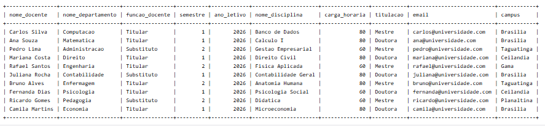

# Sistema Acadêmico — Banco de Dados MySQL

## Sobre o projeto
Projeto acadêmico desenvolvido durante o semestre de 2026 no curso de Sistemas de Informação, na disciplina de Banco de Dados.

O objetivo é representar parte da estrutura de uma instituição de ensino, organizando departamentos, docentes, disciplinas e ofertas de disciplinas, além dos vínculos entre professores e ofertas.

## Tecnologias utilizadas
- MySQL
- Linguagem SQL

## Estrutura do banco de dados
O projeto contém cinco tabelas:

| Tabela | Finalidade |
| --- | --- |
| `departamento` | Armazena os departamentos e seus campi. |
| `docente` | Registra professores, titulações e departamentos. |
| `disciplina` | Armazena disciplinas e cargas horárias. |
| `oferta_disciplina` | Registra as ofertas por semestre e ano letivo. |
| `ministra` | Relaciona docentes às ofertas de disciplinas. |

## Funcionalidades
- Criação de tabelas com chaves primárias e estrangeiras.
- Inserção de registros com `INSERT INTO`.
- Verificação da estrutura com `DESC`.
- Consulta de informações relacionadas por meio de `SELECT` e `INNER JOIN`.

## Como executar
1. Acesse um ambiente MySQL, local ou online.
2. Abra o arquivo [`sistema_academico.sql`](sistema_academico.sql) deste repositório.
3. Copie o conteúdo do arquivo para o editor SQL.
4. Execute os comandos na ordem apresentada, em um banco de dados sem essas tabelas previamente criadas.
5. Consulte o resultado do `SELECT` final para visualizar as informações relacionadas.

## Demonstração

## Contexto acadêmico
Trabalho prático desenvolvido na disciplina de Banco de Dados do curso de Sistemas de Informação, em 2026.

## Licença
Este projeto está disponibilizado sob a licença MIT. Consulte o arquivo [LICENSE](LICENSE).
